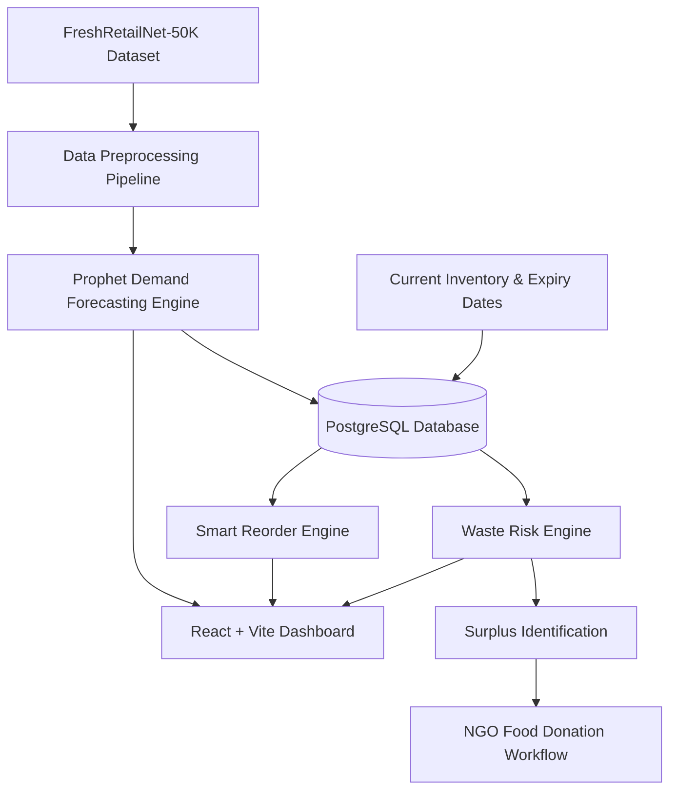

# FoodBridge AI - System Architecture

## AI Pipeline Flow

1. **Historical Sales Ingestion**: Cleaned daily time series mapped to `ds` and `y`.
2. **Prophet Model**: Trains per product time series to forecast future demand horizons (7, 14, 30 days).
3. **Waste Risk Calculation**: Evaluates Surplus Stock Ratio vs Expiry Urgency Factor to compute a 0-100 score and risk level (`LOW`, `MEDIUM`, `HIGH`, `CRITICAL`).
4. **Smart Reorder Calculation**: $\text{Recommended Quantity} = \max(0, \text{Forecast} + \text{Safety Stock} - \text{Stock})$ bounded by storage capacity limits.
5. **Redistribution**: High/Critical risk surplus inventory mapped to donation listings for NGO pickup.
